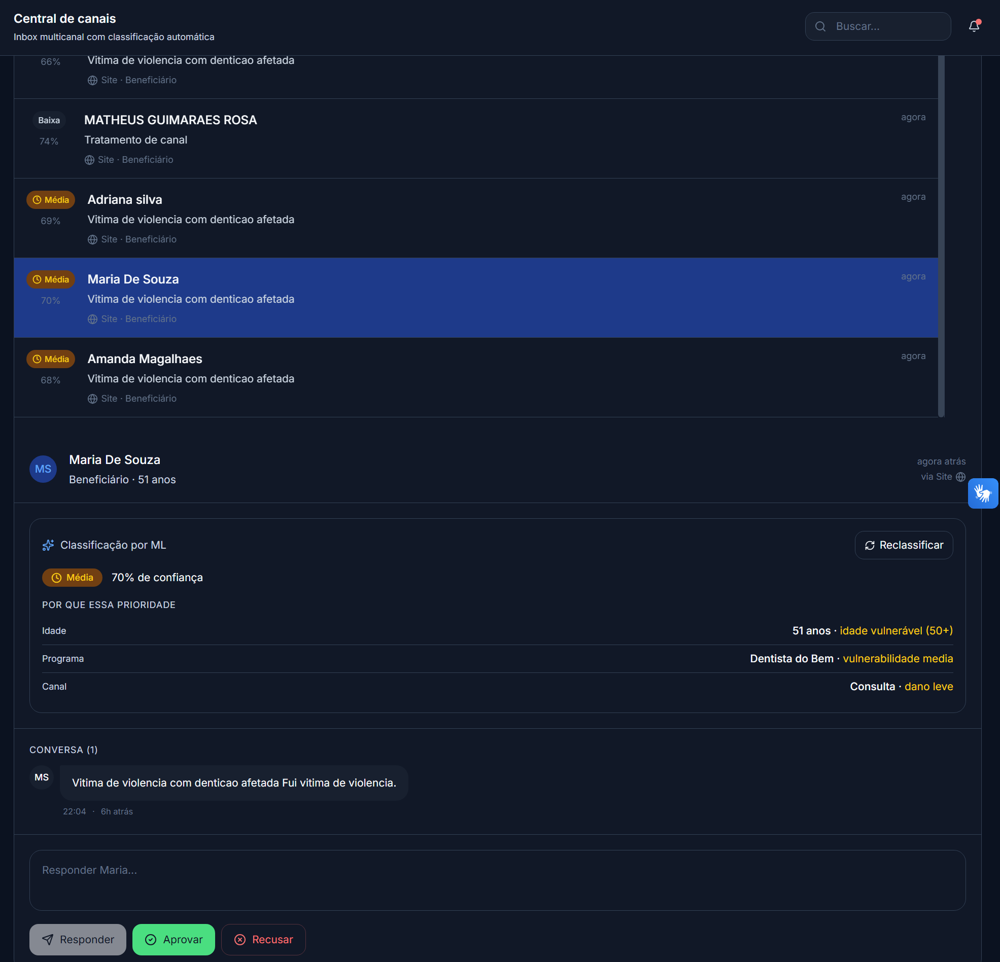
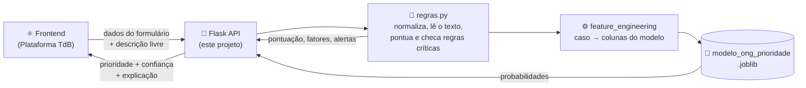

<div align="center">

# 🤖 ML_TdB — Classificador de Prioridade de Atendimentos

**API REST de Machine Learning para a ONG [Turma do Bem](https://www.turmadobem.org.br/)** — classifica solicitações de atendimento odontológico em três níveis de prioridade (**ALTA**, **MÉDIA**, **BAIXA**) usando um modelo treinado em dados reais e regras de domínio dos dois programas da ONG.

[](https://www.python.org/)
[](https://flask.palletsprojects.com/)
[](https://scikit-learn.org/)
[](https://pandas.pydata.org/)
[](https://ml-tdb.onrender.com/health)
[](LICENSE)

### 🔗 API ao vivo

[**🩺 Health check**](https://ml-tdb.onrender.com/health) &nbsp;•&nbsp; [**📋 Schema**](https://ml-tdb.onrender.com/schema) &nbsp;•&nbsp; [**🌐 Plataforma TdB**](https://www.startupados.com.br/)

</div>

---

## 📑 Sumário

- [Sobre o Projeto](#-sobre-o-projeto)
- [📸 Integração em Produção](#-integração-em-produção)
- [O Problema](#-o-problema)
- [Arquitetura](#-arquitetura)
- [Pontos Altos do Projeto](#-pontos-altos-do-projeto)
- [O Modelo](#-o-modelo)
- [Regras de Domínio](#-regras-de-domínio)
- [Stack Tecnológica](#-stack-tecnológica)
- [API — Endpoints](#-api--endpoints)
- [Estrutura de Arquivos](#-estrutura-de-arquivos)
- [Como Rodar Localmente](#-como-rodar-localmente)
- [Deploy](#-deploy)
- [Roadmap](#-roadmap)
- [Autor](#-autor)
- [Licença](#-licença)

---

---

## 📸 Integração em Produção

A API está integrada à plataforma da Turma do Bem, classificando solicitações em tempo real assim que chegam pelo formulário público. A interface mostra a classificação, a confiança do modelo e os fatores principais que levaram à decisão — permitindo ao operador entender e, se necessário, reclassificar.

<div align="center">



</div>

**O que essa tela demonstra:**

- 🎯 **Classificação automática** com nível de confiança visível (ex.: 70%)
- 🧠 **Explicabilidade da decisão** — os fatores que pesaram (idade, programa, canal, dano)
- 🔄 **Reclassificação manual** disponível quando o operador discorda do modelo
- ✅ **Fluxo de aprovação humana** preservado (Aprovar / Recusar / Responder)
- 📊 **Inbox priorizado** — solicitações ALTA aparecem com destaque visual

> Esse fluxo materializa um princípio central do projeto: **ML como assistente, não como decisor final**. O modelo sugere e justifica; o humano valida e aplica.

---

## 🎯 Sobre o Projeto

**ML_TdB** é uma API REST que serve um modelo de classificação treinado para priorizar automaticamente solicitações de atendimento da ONG **Turma do Bem**, que oferece tratamento odontológico gratuito para dois públicos em vulnerabilidade:

- **Dentista do Bem** — jovens de 11 a 17 anos em vulnerabilidade social
- **Apolônias do Bem** — mulheres vítimas de violência com dentição afetada

O modelo recebe os dados do formulário (idade, programa, renda familiar, necessidade, como soube, tempo na fila e a descrição livre) e retorna a prioridade, a confiança e os fatores que pesaram — ajudando a ONG a alocar recursos onde o impacto é maior.

> Esse projeto integra a plataforma maior **[Turma do Bem (StartUpados)](https://github.com/Start-Upados/Front_TdB)**, atendendo às solicitações recebidas pelo formulário público em [startupados.com.br](https://www.startupados.com.br/).

---

## 💡 O Problema

Quando solicitações chegam por canais digitais, a ONG enfrenta um desafio operacional: **como decidir, entre centenas de casos por mês, quais precisam de atendimento imediato?**

A priorização manual é:
- 🐢 **Lenta** — exige análise caso a caso
- 📉 **Inconsistente** — sujeita a viés e fadiga do avaliador
- 🚨 **Arriscada** — casos críticos podem ficar enfileirados por descuido

A solução automatiza essa decisão usando dados históricos da ONG e codifica as regras de negócio que profissionais experientes da área aplicariam.

---

## 🏛 Arquitetura



**Fluxo de uma requisição:**

1. O front envia os dados do formulário via `POST /predict` (o payload antigo de 9 campos também é aceito)
2. `regras.py` normaliza os textos do formulário e lê a descrição (sintomas, urgência, violência, impacto)
3. Calcula a pontuação (0–100) e verifica as regras críticas
4. O modelo prevê a faixa a partir dos fatores, com probabilidade calibrada
5. Decisão: regra crítica → ALTA; senão, a classe do modelo; fora do perfil nunca vira ALTA
6. Resposta com `prediction`, `confianca`, `pontuacao`, `fatores`, `regra_critica` e `alertas`

---

## ⭐ Pontos Altos do Projeto

### 🧠 Regras e leitura do texto no servidor
O cliente envia os dados do formulário como estão. Toda a lógica de negócio (normalização, leitura da descrição, pontuação, regras críticas) fica em `regras.py`, num lugar só, e cada decisão volta explicada.

### 📦 Pipeline Portável (joblib + módulo separado)
O `feature_engineering.py` foi deliberadamente isolado em módulo próprio, **não inline no notebook**. Isso resolve um problema clássico: modelos serializados com `joblib` quebram quando as funções customizadas não estão importáveis no servidor. A estrutura atual garante que o `.joblib` carrega corretamente em qualquer ambiente que tenha esse módulo no path.

### ✅ Validação em Camadas
Entrada do usuário passa por três validações sequenciais com erros HTTP semanticamente corretos:

1. **Aliases** — `F`, `urgente`, `apolonias_do_bem` são normalizados antes da validação
2. **Vocabulário** — só valores do `VOCAB` passam (rejeita typos e valores fora do dicionário)
3. **Tipos numéricos** — `idade` e `tempo_espera` validados como inteiros

Erros voltam estruturados em JSON com `received`, `allowed` e código HTTP apropriado (400 para input, 503 para modelo, 500 para imprevistos).

### 📜 JSON-Only Error Handling
Handlers globais (`@app.errorhandler`) garantem que **toda resposta da API é JSON** — mesmo 404, 405 e 500. Nunca um HTML inesperado quebra a integração com o frontend. Detalhe pequeno que separa API amadora de API séria.

### 📊 Probabilidades Opcionais
Se o modelo suporta `predict_proba`, a API devolve as probabilidades de cada classe junto com a predição. Útil para o frontend exibir confiança ou implementar limiares customizados (ex.: "se ALTA < 70%, marcar para revisão humana").

### 🛡 Conversão NumPy → Python Nativo
A função `_to_native` blinda a serialização contra tipos `numpy.int64`, `numpy.float64`, etc., que o `jsonify` do Flask não consegue serializar nativamente. Sem isso, a API quebra silenciosamente em endpoints como `/health`.

### 🔒 CORS Restrito por Allowlist
As origens permitidas são controladas pela variável de ambiente `CORS_ALLOWED_ORIGINS` — apenas o frontend oficial do TdB consegue consumir a API em produção. Default seguro permite só `localhost` em dev. Evita uso indevido da API por terceiros e demonstra postura de segurança proativa.

---

## 🧪 O Modelo (v2)

### Por que a v2
Na v1, quase toda solicitação saía **BAIXA com 71–73% de confiança** e nenhum jovem chegava a ALTA. Dois motivos:
1. O front montava os 9 campos a partir de palavras-chave do texto e mandava quase sempre os mesmos valores
   (`vulnerabilidade: media`, `dano: leve`, `tempo_espera: 1`). A **renda familiar** e a **necessidade** do formulário nunca chegavam ao modelo.
2. Para o Dentista do Bem, o único caminho até ALTA exigia `vulnerabilidade: alta`, que o front praticamente nunca enviava. A idade não mudava nada.

### Como funciona agora
1. **Entrada com os dados reais do formulário:** renda, necessidade, idade, como soube, dias na fila e a descrição livre.
2. **Leitura da descrição** (`regras.py`): sintomas (com negação: “sem dor” não conta), sinais de urgência, relato de violência e impacto social.
3. **Pontuação de 0 a 100** pelo critério da ONG, com o motivo de cada ponto.
4. **Modelo de ML** (HistGradientBoosting com probabilidades calibradas) decide a faixa a partir dos fatores, treinado em um dataset rotulado pelo critério (`treinar.py`).
5. **Regras críticas** levam direto para ALTA, e quem está fora do perfil do programa nunca sobe para ALTA (exceto urgência clínica).

### Métricas (teste, 2.400 casos)
| Métrica | Valor |
|---|---|
| Acurácia vs critério da ONG | **93,2%** |
| Precisão / recall de ALTA | 97% / 93% |
| Distribuição prevista | ALTA 29% · MÉDIA 48% · BAIXA 23% |
| Confiança | mediana 0,91; cai para ~0,6 em casos de fronteira |

> O dataset é **sintético**, gerado com distribuições parecidas com o público de cada programa e rotulado pelo critério.
> Perto dos limites de faixa, parte dos rótulos é sorteada para a faixa vizinha (simula a discordância entre avaliadores).
> Assim que houver decisões reais da equipe, retreine com `python treinar.py --reais casos.csv` (esses casos pesam 5x).

---

## 🚨 Regras de Domínio (v2)

Faixas: **ALTA ≥ 65 pontos · MÉDIA 40–64 · BAIXA < 40**

### Dentista do Bem (jovens 11–17)
| Fator | Pontos |
|---|---|
| Renda até 1 SM / 1–2 SM / 2–3 SM / acima de 3 SM / não informada | 30 / 20 / 8 / 0 / 12 |
| Idade 17 / 16 / 15 / 14 / 11–13 (janela até os 18) | 15 / 12 / 8 / 5 / 3 |
| Necessidade canal / extração / restauração / outro / ortodontia / limpeza | 25 / 22 / 14 / 8 / 6 / 3 |
| Sintoma grave / moderado / leve (lido da descrição) | 25 / 12 / 3 |
| Tempo na fila | +2 por semana (máx. 15) |
| Encaminhado por posto/escola / rede de proteção | 4 / 8 |
| Relato de violência · impacto social (escola, autoestima) | 10 · 5 |

**ALTA direto:** renda até 1 SM + canal/extração · 17 anos + renda até 2 SM + canal/extração/restauração ·
baixa renda + dor + canal/extração · adolescente com relato de violência.

### Apolônias do Bem (mulheres)
| Fator | Pontos |
|---|---|
| Vítima de violência com dentição afetada / não informado / não | 40 / 15 / 0 |
| Idade < 18 / 60+ / 50–59 / 40–49 | 12 / 10 / 8 / 4 |
| Sintoma grave / moderado / leve | 25 / 12 / 3 |
| Encaminhada por Delegacia/CREAS · posto de saúde | 10 · 4 |
| Necessidade canal/extração · restauração | 15 · 8 |
| Tempo na fila · impacto social | +2/semana (máx. 15) · 5 |

**ALTA direto:** menor vítima de violência · vítima com dano grave (dente quebrado/perdido, dor forte) ·
vítima encaminhada por Delegacia/CREAS com dor.

### Os dois programas
- **Urgência clínica → ALTA:** abscesso, pus, inchaço, febre, sangramento, infecção, dor que impede comer/dormir.
- **Fora do perfil** (jovem fora de 11–17, mulher sem relato de violência) → alerta para conferir a elegibilidade, sem ALTA.

---

## 🛠 Stack Tecnológica

| Camada | Tecnologia |
|---|---|
| **Linguagem** | Python 3.11+ |
| **Framework Web** | Flask + Flask-CORS |
| **ML / Pipeline** | scikit-learn 1.6.1 |
| **Processamento** | pandas + numpy |
| **Serialização** | joblib |
| **Servidor de Produção** | Gunicorn |
| **Hospedagem** | Render.com |

---

## 🔌 API — Endpoints

### `GET /health`
Verifica se o serviço está no ar e o modelo carregado.

**Resposta:**
```json
{
  "status": "ok",
  "model_loaded": true,
  "classes": [0, 1, 2]
}
```

### `GET /schema`
Documenta o contrato da API — útil para frontend e debug.

**Resposta:**
```json
{
  "required_fields": ["programa", "tempo_espera", "sexo", "idade", ...],
  "vocabulary": { "programa": ["apolonas_do_bem", "dentista_do_bem"], ... },
  "aliases_accepted": { "sexo": {"F": "feminino", "M": "masculino"}, ... },
  "example_request": { ... }
}
```

### `POST /predict`
Classifica uma solicitação. Aceita os textos do formulário do site como estão.
O payload antigo (v1, 9 campos) continua aceito.

**Request:**
```json
{
  "programa": "Dentista do Bem",
  "idade": 15,
  "sexo": "masculino",
  "renda_familiar": "Ate 1 salario minimo",
  "necessidade": "Restauracao",
  "como_soube": "Escola",
  "texto": "Sente dor no dente faz 3 semanas",
  "tempo_espera": 21
}
```

**Response (200):**
```json
{
  "prediction": "ALTA",
  "confianca": 0.65,
  "probabilities": { "ALTA": 0.65, "MEDIA": 0.35, "BAIXA": 0.0 },
  "origem": "modelo",
  "pontuacao": 74,
  "prioridade_criterio": "ALTA",
  "regra_critica": null,
  "fatores": [
    { "fator": "Renda: até 1 salário mínimo", "pontos": 30 },
    { "fator": "Necessidade: restauração", "pontos": 14 },
    { "fator": "Sintoma moderado (\"dor\")", "pontos": 12 }
  ],
  "alertas": [],
  "modelo_versao": "ml-tdb-v2"
}
```

### Exemplo com `curl`

```bash
curl -X POST https://ml-tdb.onrender.com/predict \
  -H "Content-Type: application/json" \
  -d '{
    "programa": "Apolônias do Bem",
    "idade": 42,
    "sexo": "feminino",
    "necessidade": "Vitima de violencia com denticao afetada",
    "como_soube": "Delegacia/CREAS",
    "texto": "Perdi dois dentes depois de uma agressão",
    "tempo_espera": 3
  }'
```

**Teste rápido em produção:**

```bash
curl https://ml-tdb.onrender.com/health
curl https://ml-tdb.onrender.com/schema
```

---

## 📂 Estrutura de Arquivos

```
ML_TdB/
├── app.py                          # API Flask (endpoints + decisão final)
├── regras.py                       # Critério da ONG: normalização, leitura do texto, pontuação, regras críticas
├── feature_engineering.py          # Caso → colunas do modelo + compatibilidade com payload v1
├── treinar.py                      # Gera o dataset, treina e mede o modelo
├── modelo_ong_prioridade.joblib    # Modelo treinado (v2)
├── modelo_ong_prioridade.metricas.json
├── requirements.txt
├── LICENSE
└── README.md
```

---

## ▶️ Como Rodar Localmente

**Pré-requisitos:** Python 3.11+.

```bash
# 1. Clonar o repositório
git clone https://github.com/<seu-usuario>/ML_TdB.git
cd ML_TdB

# 2. Criar e ativar ambiente virtual
python -m venv .venv
.\.venv\Scripts\activate          # Windows
# source .venv/bin/activate        # Linux/Mac

# 3. Instalar dependências
pip install -r requirements.txt

# 4. Rodar localmente
python app.py
```

A API ficará disponível em `http://localhost:5000`.

Teste rapidamente:

```bash
curl http://localhost:5000/health
curl http://localhost:5000/schema
```

---

## 🚀 Deploy

A API está deployada no **Render** e consumida em produção pela plataforma da ONG Turma do Bem.

### Comando de inicialização (Gunicorn)

```bash
gunicorn app:app
```

> ⚠️ **Cold start:** no plano gratuito do Render, o serviço hiberna após 15 min de inatividade. A primeira requisição pode levar até ~60s para "acordar" o serviço. A plataforma do TdB lida com isso fazendo um _ping_ ao `/health` no carregamento das telas que dependem da predição.

### Variáveis de ambiente opcionais

| Variável | Default | Descrição |
|---|---|---|
| `PORT` | `5000` | Porta em que o servidor escuta |
| `MODEL_PATH` | `./modelo_ong_prioridade.joblib` | Caminho do modelo serializado |
| `CORS_ALLOWED_ORIGINS` | `http://localhost:5173,http://localhost:3000` | Lista de origens permitidas (separadas por vírgula) |

> 🔒 **Em produção, sempre configure `CORS_ALLOWED_ORIGINS`** com as URLs reais do frontend. O default só libera localhost para desenvolvimento — em produção, sem essa variável, a API rejeitará requisições do site oficial.

---

## 🔜 Roadmap

- [x] API REST com 3 endpoints (`/health`, `/schema`, `/predict`)
- [x] Feature engineering server-side
- [x] Validação em camadas (aliases → vocab → tipos)
- [x] Probabilidades opcionais por classe
- [x] Deploy em produção no Render
- [x] Integração com a plataforma Turma do Bem
- [x] **CORS restrito** a origens conhecidas via variável de ambiente
- [x] Explicação por predição (`fatores`, `regra_critica`, `alertas`) — v2
- [x] Uso dos dados reais do formulário (renda, necessidade, tempo na fila) — v2
- [ ] Retreino com as decisões reais da equipe (`treinar.py --reais`)
- [ ] Métricas de uso (Prometheus / observabilidade)
- [ ] Versionamento do modelo via `/predict?v=1.2`
- [ ] Pipeline de retraining automatizado

---

## 👤 Autor

Desenvolvido por **Pedro Henrique Falchi** como parte da plataforma **Turma do Bem (StartUpados)** — FIAP 2026.

[](https://github.com/pedrofalchi-fullstack)
[](https://www.linkedin.com/in/pedro-henrique-falchi-4ab4b937b)

---

## 📄 Licença

Este projeto está licenciado sob a **Licença MIT** — consulte o arquivo [`LICENSE`](LICENSE) para mais detalhes.

---

<div align="center">

_Machine learning a serviço de quem precisa._ 🦷❤️

</div>
